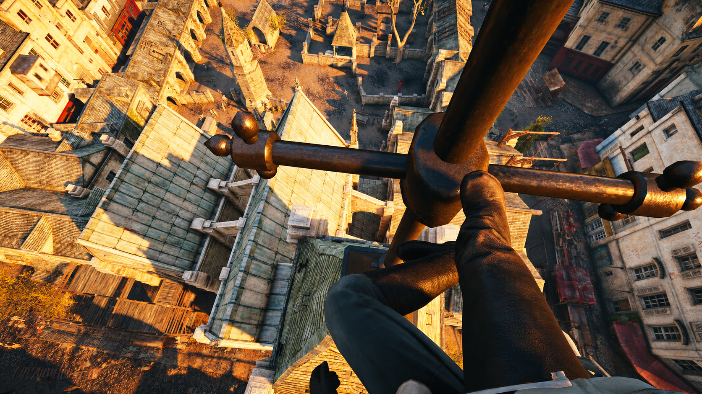

# ACUnityFirstPerson

A first-person camera for **Assassin's Creed Unity** on PC, delivered as a plugin for the
[ACUFixes Plugin Loader](https://github.com/NameTaken3125/ACUFixes).

Press **.** to toggle first person. The camera follows Arno's animated head, hides the head
and hood from the main view while keeping his cast shadow, and pulls back automatically when
you run into geometry.

> **Status: 0.8.4 — playable, actively developed.** Ordinary walking and parkour are the
> best-tested paths.



## Current local mod and visual setup

The screenshot above was captured from a local ACU install using:

- **ACUFixes Plugin Loader** 0.9.2, with the **ACUFixes** base fixes enabled.
- **ACUnityFirstPerson** — first-person camera plugin.
- **CamnKaboom** — installed ACUFixes plugin.
- **Combat Features** — installed ACUFixes plugin.
- **VisualCustomization** — enabled with outfit, cloth, rendering, LOD and effect-removal settings.
- **NewAnimations** — ACVI upper-body hood/hat animation replacements.
- **ReShade 6.8.0.2158** via `dxgi.dll`, loading the `HD_Realism.ini` preset. Its recorded effect stack includes SMAA, Deband, ColorMatrix, Tonemap, Curves, AmbientLight, Technicolor2 and LumaSharpen.

This describes the current local capture environment; the first-person plugin itself only requires
the ACUFixes Plugin Loader.

## Requirements

- Assassin's Creed Unity, PC, 64-bit. Built and tested against the current Steam/Uplay
  `ACU.exe` (SHA-256 `748ABDC6456397FE7D8080F975F2A5ED3123BCE548E7BF1C68B23F47E8B27E40`).
- [ACUFixes Plugin Loader](https://github.com/NameTaken3125/ACUFixes) installed and working
  (developed against loader 0.9.2). This plugin does nothing on its own.
- DirectX / ReShade and other plugin-loader mods are fine; the mod makes no global game hooks.

## Installation

1. Install the ACUFixes Plugin Loader first and confirm it loads.
2. Copy `ACUnityFirstPerson.dll` into:
   ```
   <Assassin's Creed Unity>\ACUFixes\plugins\
   ```
3. Copy `ACUnityFirstPerson.ini` into the same folder if you don't already have one.
   An existing INI is never overwritten on upgrade — new keys fall back to their defaults.
4. Launch the game and load a save. Restart the game after installing or replacing the DLL.

The archive mirrors the layout above, so you can drop its `ACUFixes` folder straight into
your game folder instead of copying the two files by hand.

## Usage

| Action | Default |
| --- | --- |
| Toggle first person | `.` (period) |
| Open the settings panel | ACUFixes Plugin Loader menu (`Insert`) → `ACUnityFirstPerson` |

The panel is where you should change things: it applies camera and keybinding changes
without a restart, and `Save & apply` writes them to the INI. If you edit the INI by hand
while the game is running, restart the game for the change to take effect.

`Insert`, mouse buttons and modifier-only keys are reserved and can't be bound.
The mod never touches Unity's own controls, so nothing you have bound in-game stops working.
Period was chosen because the game doesn't use it by default; if it clashes with something
else you have installed, rebind the toggle in the menu.

## Configuration

`ACUnityFirstPerson.ini`, section `[Camera]`:

| Key | Default | Meaning |
| --- | --- | --- |
| `ToggleKey` | `190` | Virtual-key code (`190` = period). Set it in the menu if you can. |
| `TrackAnimatedHead` | `1` | Required. Head tracking is the whole point; `0` is not a supported mode. |
| `HeadEyeHeight` | `0.12` | Eye height relative to the tracked head, in metres. |
| `HeadForward` | `0.16` | Eye forward offset, in metres. |
| `EyeHeight` | `1.65` | Fallback eye height used when head tracking drops out. |
| `VerticalFOV` | `70` | Vertical FOV in degrees, `40`-`100`. `0` keeps the game's native FOV. |
| `HeadSmoothingHalfLife` | `0.07` | Animation smoothing half-life in seconds. Raise it to calm fast poses. |
| `HideHead` | `1` | Hide the head/hood in the main view. Shadows are preserved. |
| `CollisionGuard` | `1` | Probe for geometry and pull the camera back instead of clipping. |
| `CollisionPadding` | `0.12` | Clearance kept in front of the eye, in metres. |
| `CollisionRadius` | `0.16` | Probe radius, in metres. |
| `AutoThirdPerson` | `0` | `0` stays first person through turns and local corrections. `1` restores the older automatic fallback thresholds. |
| `CombatFraming` | `1` | Lower, tighter framing while in combat. |
| `CombatEyeHeight` | `-0.06` | Combat eye height relative to the tracked head. |
| `CombatForward` | `0.02` | Combat forward offset. |
| `CombatVerticalFOV` | `80` | Combat vertical FOV. Wider existing FOVs are preserved. |
| `FollowCombatMotion` | `1` | Follow recognised ground rolls. Ordinary combat keeps native aim. |
| `FollowLeapOfFaith` | `1` | Follow the Leap of Faith dive, independently of the combat options. |

`MaxLookYaw`, `MaxLookDown`, `MaxLookUp` and `ForwardOffset` are kept only so old
configurations load cleanly. They are inactive.

Because the mod rewrites per-frame camera output, install it on a save you don't mind
losing, and keep a clean backup of your `ACUFixes` folder.

## Uninstalling

Delete `ACUnityFirstPerson.dll` from `ACUFixes\plugins\`. The INI and logs are left behind;
delete those too if you want a clean slate. `scripts/uninstall.ps1` does the DLL removal.

## Building from source

Requires Windows x64, the Visual Studio 2026 C++ tools, a Windows SDK and CMake on `PATH`.

```powershell
.\scripts\build.ps1              # configure, build Release, run CTest
.\scripts\package.ps1            # build + emit dist\ACUnityFirstPerson-<version>.zip
```

Output: `build\Release\ACUnityFirstPerson.dll`. Eight CTest groups cover camera geometry,
comfort limits, head anchoring, combat framing, body motion, head visibility flags,
settings persistence and the plugin-loader contract.

`scripts\install.ps1 -GamePath "<your game folder>"` copies a freshly built DLL into
`ACUFixes\plugins`, backing up anything it replaces.

## Credits and licensing

- **ACUFixes Plugin Loader** by [NameTaken3125](https://github.com/NameTaken3125/ACUFixes) —
  required dependency. No ACUFixes source is compiled into this mod; only its published
  interoperability offsets are used.
- **Dear ImGui** 1.92.0 WIP (19195), MIT licensed, vendored in `third_party/imgui`.
  Its license ships beside the DLL as `ACUnityFirstPerson-ImGui-LICENSE.txt`.
- Head-tracking and camera-ABI research drew on
  [assassins-creed-unity-headtracking](https://github.com/itsloopyo/assassins-creed-unity-headtracking)
  (MIT). This mod's implementation is independent and shares no code with it.

This mod is [MIT licensed](LICENSE). It is unofficial and not affiliated with or endorsed by
Ubisoft. Assassin's Creed Unity is a trademark of Ubisoft Entertainment. No game assets or
game code are redistributed here — you must own the game.
